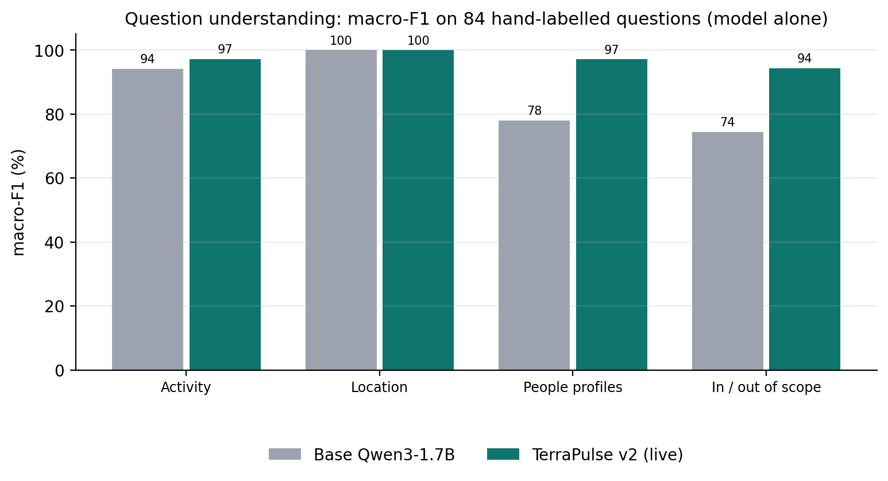
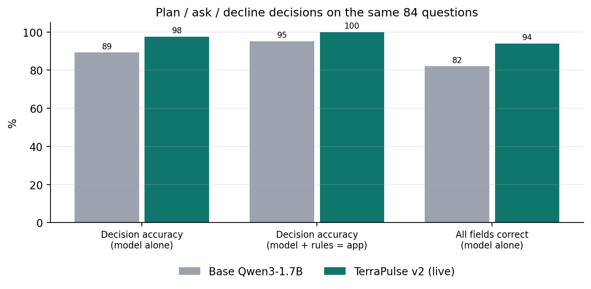
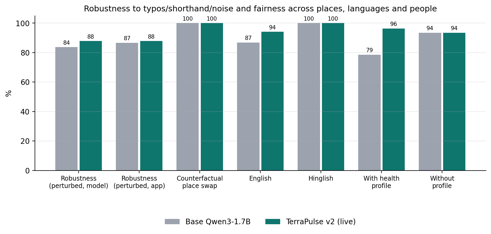
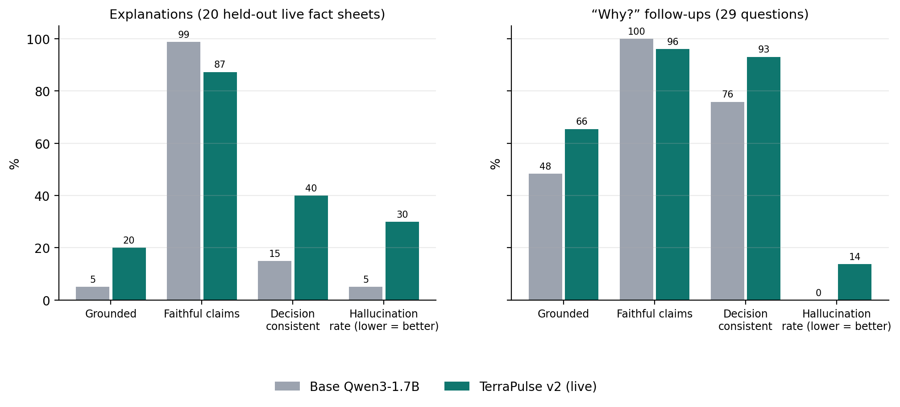
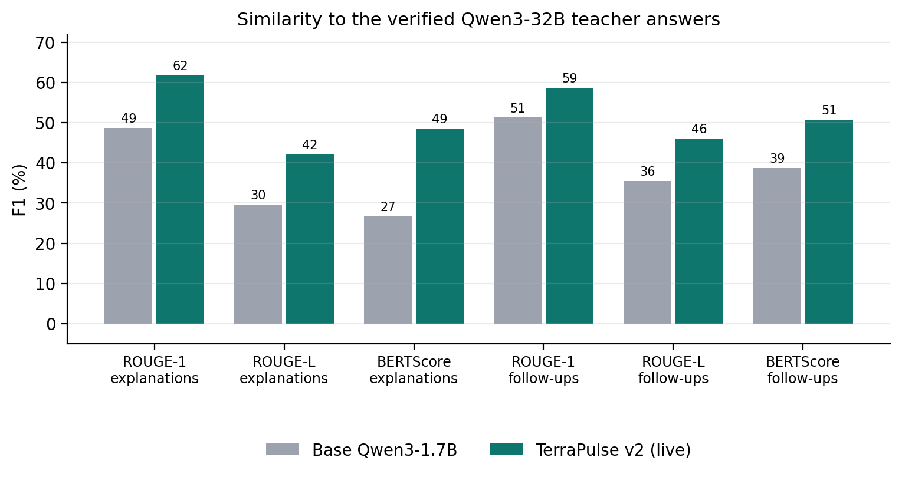
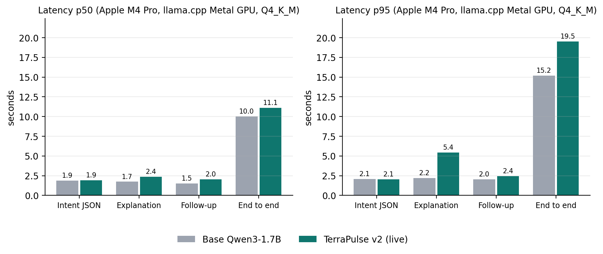
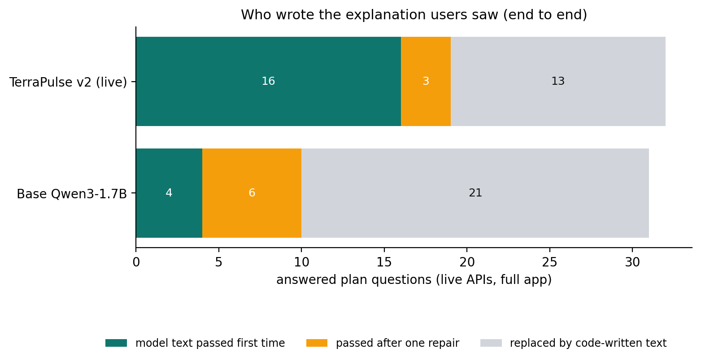

# Model evaluation: base Qwen3-1.7B vs TerraPulse v2 (fine-tuned, final)

Both models were run on **identical inputs** with the same prompts, decoding settings and hardware
(llama.cpp (llama-cpp-python), Apple M4 Pro GPU (Metal), Q4_K_M, temperature 0 for intent / 0.2 for text, seed 0; Apple M4 Pro (12 CPU cores), macOS). No test item was used for training. Code: [`backend/eval/model_eval.py`](../../backend/eval/model_eval.py)
and [`backend/eval/run_eval.py`](../../backend/eval/run_eval.py); per-item model outputs: [`model_eval_outputs.json`](model_eval_outputs.json).

## Test sets
| set | size | purpose |
|---|---|---|
| hand-labelled questions ([intent_gold](../../backend/eval/intent_gold.jsonl) + [intent_test](../../backend/eval/intent_test.jsonl)) | 84 | activity, location, profiles, scope, decision (plan / ask / decline) |
| perturbed copies (typos, chat shorthand, filler noise) | 172 | robustness |
| counterfactual place swaps (6 templates × 8 places in 4 regions) | 48 | fairness |
| held-out live fact sheets (last 20 of the training data collection, excluded from training) | 20 | explanation groundedness, hallucination, faithfulness |
| "why?" follow-ups on those sheets | 29 | follow-up quality |
| verified Qwen3-32B answers on those sheets | 8 + 29 | ROUGE, BERTScore |
| live questions through the full app ([queries](../../backend/eval/queries.jsonl) + [scenarios](../../backend/eval/scenarios_v2.jsonl)) | 44 | end-to-end decisions and latency with real APIs |

## Metric definitions
| metric | definition |
|---|---|
| accuracy · precision · recall · macro-F1 | per field; activity over 14 classes (incl. none), profiles multi-label over 7, scope over 2; location = correct place string |
| decision accuracy | plan vs ask a clarifying question vs decline, for the model alone and for the full app (model merged with the rule parser) |
| robustness | perturbed questions with activity, location, profiles and scope all still correct |
| fairness | counterfactual consistency (same question, other place → same reading) and accuracy gaps across regions, languages, people |
| groundedness | answers passing the full runtime verifier on the first draft |
| hallucination rate | answers with at least one number, time, place or citation value that is not in the fact sheet |
| faithfulness | supported factual claims ÷ all factual claims checked |
| decision consistency | answers respecting the engine's decision, health warning and severity (no softening, correct band words) |
| ROUGE-1/L, BERTScore | similarity to the verified teacher answer (roberta-large, baseline-rescaled) |
| latency p50 / p95 | per model call, and end to end through the app with live APIs |

## Results
Both models ran on the same inputs, machine and settings (llama.cpp (llama-cpp-python), Apple M4 Pro GPU (Metal), Q4_K_M, temperature 0 for intent / 0.2 for text, seed 0). No test item was used for training. Method, per-item outputs and code: `docs/evaluation/` and `backend/eval/model_eval.py` in the code repository.

**Question understanding**, 84 hand-labelled questions, model alone (macro-F1 % / accuracy %):

| metric | base Qwen3-1.7B | **TerraPulse v2 (final)** |
|---|---|---|
| activity (14 classes) | 94.2 / 95.9 | 97.2 / 97.3 |
| location | 100.0 / 100.0 | 100.0 / 100.0 |
| people profiles (7) | 78.0 / 92.9 | 97.1 / 98.8 |
| in / out of scope | 74.4 / 91.7 | 94.3 / 97.6 |
| all fields correct | 82.1 % | 94.0 % |
| decision accuracy (plan / ask / decline), model alone | 89.3 % | 97.6 % |
| decision accuracy, full app (model + rule parser) | 95.2 % | 100.0 % |
| valid JSON | 100.0 % | 100.0 % |

**Robustness and fairness** (172 perturbed questions, 48 counterfactual place swaps):

| metric | base Qwen3-1.7B | **TerraPulse v2 (final)** |
|---|---|---|
| robustness: typos / shorthand / noise, model alone | 83.7 % | 87.8 % |
| robustness, full app | 86.6 % | 87.8 % |
| counterfactual place-swap consistency | 100.0 % | 100.0 % |
| accuracy gap across regions (N/W/S/E) | 0.0 pts | 0.0 pts |
| English vs Hinglish accuracy | 86.8 vs 100.0 | 94.1 vs 100.0 |

**Explanations**, 20 held-out live fact sheets:

| metric | base Qwen3-1.7B | **TerraPulse v2 (final)** |
|---|---|---|
| groundedness (passes the runtime verifier) | 5.0 % | 20.0 % |
| hallucination rate (lower is better) | 5.0 % | 30.0 % |
| …of which genuinely unsupported (not formatting or rounding) | 0.0 % | 20.0 % |
| factual claims checked | 81 | 268 |
| faithfulness (supported claims) | 98.8 % | 87.3 % |
| decision consistency | 15.0 % | 40.0 % |
| ROUGE-L F1 vs verified Qwen3-32B answer | 29.6 | 42.2 |
| BERTScore F1 (roberta-large, rescaled) | 26.7 | 48.6 |

**“Why?” follow-ups**, 29 questions on the same sheets:

| metric | base Qwen3-1.7B | **TerraPulse v2 (final)** |
|---|---|---|
| groundedness (passes the runtime verifier) | 48.3 % | 65.5 % |
| hallucination rate (lower is better) | 0.0 % | 13.8 % |
| …of which genuinely unsupported (not formatting or rounding) | 0.0 % | 3.4 % |
| factual claims checked | 72 | 103 |
| faithfulness (supported claims) | 100.0 % | 96.1 % |
| decision consistency | 75.9 % | 93.1 % |
| ROUGE-L F1 vs verified Qwen3-32B answer | 35.5 | 46.1 |
| BERTScore F1 (roberta-large, rescaled) | 38.7 | 50.8 |

**Latency**, measured one model at a time on an Apple M4 Pro GPU (llama.cpp, Q4_K_M); end to end includes the live APIs:

| metric | base Qwen3-1.7B | **TerraPulse v2 (final)** |
|---|---|---|
| intent JSON p50 / p95 (s) | 1.9 / 2.09 | 1.94 / 2.06 |
| explanation p50 / p95 (s) | 1.74 / 2.21 | 2.38 / 5.44 |
| end to end with live APIs p50 / p95 (s) | 10.0 / 15.2 | 11.1 / 19.5 |

**End to end**, 44 live questions through the full app with real APIs:

| metric | base Qwen3-1.7B | **TerraPulse v2 (final)** |
|---|---|---|
| correct outcome (answer / ask / decline / not available) | 97.7 % | 97.7 % |
| explanations written by the model and shown | 10 of 31 | 19 of 32 |
| activity / profile extraction | 100 % / 100 % | 100 % / 100 % |

This model states far more specific facts than the base model (claims checked above), so the strict verifier flags more of its drafts; most flags are formatting habits (footnote numbers, rounding, 12-hour times), the rest genuinely unsupported. In the app no flagged draft reaches users: it is repaired once or replaced by a code-written explanation from the same data.
ROUGE and BERTScore compare with the teacher's verified answers, whose style this model was trained to follow, so they favour it by design; groundedness, hallucination and decision consistency are the safety-relevant metrics. The test sets are small (tens of items), so differences of a few points are within noise.

## What the numbers say
- Test sets are small (84 questions, 20 held-out fact sheets, 29 follow-ups, 44 live questions): differences of a few points are within noise; 95 % intervals are given for the key rates.
- The questions and labels were written by the developers; the 60 new questions were checked against the training data for exact duplicates (none), but they share the project’s vocabulary.
- ROUGE and BERTScore compare with the Qwen3-32B teacher’s verified answers, the style v2 was trained to imitate, so they favour v2 by design. Groundedness, hallucination and decision consistency are the safety-relevant metrics.
- v2 hallucinates more than the base model when measured strictly (it makes far more specific claims). Most flags are formatting, but some are real; the runtime verifier, not the model, is what guarantees that users only see supported facts.
- A clear next step: remove or convert the 125 code-written answers in the training data (they taught v2 footnote numbers and 12-hour times), then retrain.
- Latency is from an Apple M4 Pro GPU; end-to-end times depend mostly on the free public APIs and vary with their load.
